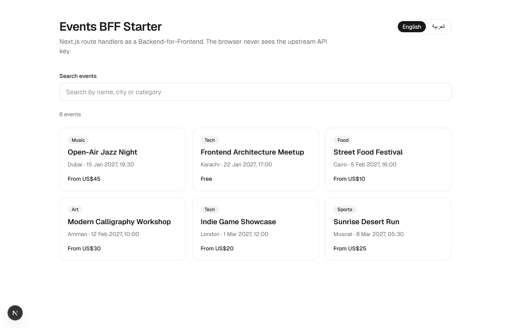
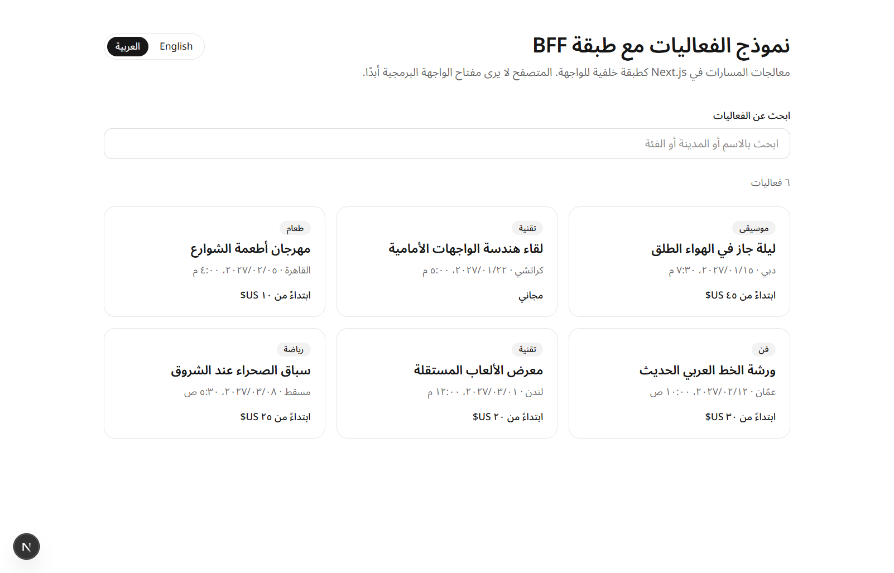
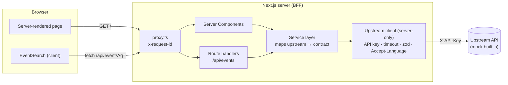

# nextjs-bff-starter

[](https://github.com/MuhammadHaseebKhan/nextjs-bff-starter/actions/workflows/ci.yml)


A production-minded Next.js (App Router) starter that uses route handlers as a **Backend-for-Frontend (BFF)**. The browser only talks to the Next.js server; the server talks to the upstream API with a credential the browser never sees.

It runs with **zero external services**: a mock upstream ships inside the app.

| English | العربية (RTL) |
|---|---|
|  |  |

## What it demonstrates

- **Server-only secrets.** The upstream API key is injected by a `server-only` client; importing it from client code is a build error. ([ADR 1](docs/adr/0001-route-handlers-as-a-bff.md))
- **A stable UI contract.** Upstream responses are validated with zod and mapped to the BFF's own types in one file. An invalid payload fails fast instead of rendering `undefined`.
- **Typed failure handling.** Timeouts, network errors, auth failures and bad payloads become a typed `UpstreamError`, then RFC 9457 `problem+json` responses that never leak upstream details. ([ADR 4](docs/adr/0004-problem-details-errors.md))
- **English / Arabic with RTL.** The locale lives in a cookie, so it survives full-page redirects (hosted checkout, OAuth) and reaches route handlers, which forward it as `Accept-Language`. ([ADR 2](docs/adr/0002-locale-in-a-cookie.md))
- **Streaming UI.** Data-dependent sections stream inside `<Suspense>`; client-side search goes through the BFF with debouncing and request cancellation.
- **Traceability.** Every request gets an `x-request-id` that is forwarded upstream, returned to the client, and written to redacted JSON logs.
- **CI quality gates.** Lint, type-check, 40 unit tests, production build and gitleaks secret scanning on every push.

## Architecture



## Getting started

```bash
npm install
cp .env.example .env.local
npm run dev
```

Open [http://localhost:3000](http://localhost:3000) and switch to العربية in the top corner.

### Environment

| Variable | Default (`.env.example`) | Purpose |
|---|---|---|
| `UPSTREAM_API_URL` | `http://localhost:3000/mock-upstream` | Base URL of the upstream API |
| `UPSTREAM_API_KEY` | `local-dev-key` | Injected server-side into every upstream request |
| `UPSTREAM_TIMEOUT_MS` | `5000` | Per-request upstream timeout |
| `ENABLE_MOCK_UPSTREAM` | `true` | Serve the built-in mock; set `false` in production |

All variables are server-only. The app validates them on first use and lists every invalid key.

## Project structure

```
src/
  app/
    api/events/            BFF route handlers (browser-facing)
    events/[id]/           Event detail page
    mock-upstream/         Built-in mock upstream API
  components/              UI components (search, cards, language switcher)
  domain/                  The BFF's public contract (safe for client code)
  i18n/                    Locale config, dictionaries, formatting, Server Action
  server/
    upstream/              Server-only upstream client and error types
    http/                  problem+json mapping and route error handling
    events.ts              Service layer: upstream shapes → contract
    log.ts                 Structured JSON logging with PII redaction
  proxy.ts                 Request id assignment
docs/adr/                  Architecture decision records
```

## Scripts

| Script | What it does |
|---|---|
| `npm run dev` | Start the dev server |
| `npm run build` | Production build |
| `npm test` | Unit tests (Vitest + React Testing Library) |
| `npm run lint` | ESLint |
| `npm run typecheck` | Generate route types, then `tsc --noEmit` |

## Architecture decisions

1. [Use route handlers as a BFF](docs/adr/0001-route-handlers-as-a-bff.md)
2. [Keep the locale in a cookie](docs/adr/0002-locale-in-a-cookie.md)
3. [Ship a mock upstream inside the app](docs/adr/0003-mock-upstream-in-the-app.md)
4. [Return problem details, log the real cause](docs/adr/0004-problem-details-errors.md)

## License

[MIT](LICENSE)
